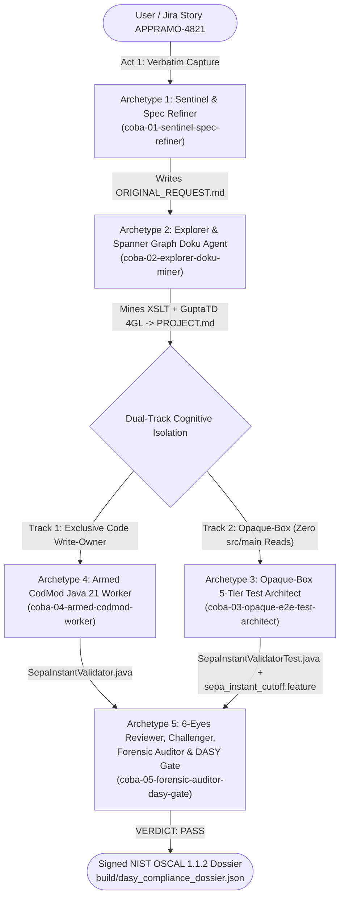

# Regulated FSI Agentic SDLC Blueprint: 5 Agent Archetypes, Dual-Lane Governance & SEPA Instant Modernization (`/teamwork-preview` + Google ADK 2.0)

[](#)
[](#)
[](#)
[](#)

> **Tags / Topics**: `#spark-build` `#spark-build-day` `#spark-build-days` `#emea-asset` `#agentic-sdlc` `#antigravity` `#google-adk` `#teamwork-preview` `#fsi` `#banking` `#sepa-instant` `#iso20022` `#bafin` `#dora` `#oscal` `#spanner-graph` `#mcp` `#java21` `#legacy-modernization`

---

## 1. Executive Summary & Strategic Goal

European Tier-1 banks face a dual mandate:
1. **Accelerate Legacy Brownfield Modernization** (such as migrating undocumented `XSLT` payment gateways and `Gupta Team Developer 4GL` routines into modern **Java 21** microservices across **10M+ Lines of Code**).
2. **Enforce Strict Regulatory Assurance** under **BaFin MaRisk AT 7.2 / BAIT**, **EU DORA (Regulation 2022/2554) Articles 9 & 11**, and the **6-Eyes Principle**—while empowering not just Software Engineers, but also **1,500+ non-coding Product Owners (POs), Business Analysts, and Test Analysts**.

This repository provides a complete, production-grade **Agentic SDLC Reference Architecture, 5 Agent Archetypes, Reusable Skills Factory, Deterministic Guardrail Hooks, and End-to-End Live Demos** runnable locally, in CI/CD (`OneCI` / Cloud Build), or on **Google Cloud Run + Google ADK 2.0 (`/dev-ui/`)**.

---

## 2. Complete Artifact Descriptions & Strategic Goals

Every artifact in this repository has a specific architectural purpose and business goal in convincing SDLC leadership, AI architects, and CCoE platform teams:

### A. The 5 Agent Archetypes (`agents/` & `.agents/agents/`)

| Artifact Path | Description | Strategic Goal of Using This Artifact |
|---|---|---|
| [`agents/coba-01-sentinel-spec-refiner.md`](agents/coba-01-sentinel-spec-refiner.md) | **Archetype 1 — Sentinel & 5-Stage Spec Refiner** (`/ideate` → `/pm-grill-me` → `/write-prd` → `/red-team-prd` → `/decompose-epic`) | **Eliminate Requirement Ambiguity & Scope Drift**: Captures the user's verbatim prompt into an immutable baseline (`ORIGINAL_REQUEST.md`) before any planning occurs, and conducts Socratic requirement interrogation (`/pm-grill-me`) so edge cases (rounding modes, millisecond cutoffs, ISO-20022 error codes) are locked into a BaFin/DORA-compliant PRD before code is written. |
| [`agents/coba-02-explorer-doku-miner.md`](agents/coba-02-explorer-doku-miner.md) | **Archetype 2 — Explorer, Legacy Spec Miner & Spanner Graph Doku Agent** | **Cure Context Exhaustion Across 10M+ LoC & End Documentation Drift**: Connects via MCP to **Cloud Spanner Graph (`EuroBankEnterpriseSDLCGraph`)** to perform 4-hop cross-repository impact analysis in `~180ms` (`1,420` tokens vs. `>180,000` raw `grep` tokens), extracts 100% of hidden business rules from legacy `TRACE XSLT` and `SecOffice GuptaTD 4GL` into `PROJECT.md § Feature Inventory`, and auto-generates living C4/Arc42 architecture docs. |
| [`agents/coba-03-opaque-e2e-test-architect.md`](agents/coba-03-opaque-e2e-test-architect.md) | **Archetype 3 — Track 2 Opaque-Box 5-Tier E2E Test Architect & BDD Synthesizer** | **Prevent Tautological AI Tests & Empower 1,500 Test Analysts**: Enforces **cognitive isolation**—this agent is *strictly forbidden* from reading the implementation source code (`src/main/java/`) and builds its 5-Tier test suite (`SepaInstantValidatorTest.java`) and Cucumber/Gherkin `.feature` tables (`sepa_instant_cutoff.feature`) solely from `ORIGINAL_REQUEST.md` and `PROJECT.md`. |
| [`agents/coba-04-armed-codmod-worker.md`](agents/coba-04-armed-codmod-worker.md) | **Archetype 4 — Track 1 Armed Modernization Worker (`CodMod` Java 21 Engineer)** | **Enforce Single-Writer Accountability & Deterministic Banking Precision**: Acts as the *exclusive* code write-owner on `src/main/java/` inside a rootless `gVisor` (`runsc`) sandbox, translating legacy XSLT/4GL code into modern Java 21 records using `BigDecimal` with `RoundingMode.HALF_EVEN` (Bankers' Rounding). |
| [`agents/coba-05-forensic-auditor-dasy-gate.md`](agents/coba-05-forensic-auditor-dasy-gate.md) | **Archetype 5 — 6-Eyes Reviewer, Empirical Challenger, Forensic Auditor & DASY OSCAL Gate** | **Guarantee Regulatory Compliance & Automate Release Governance**: Combines Code Review (Eyes 1–2), Adversarial Boundary Challenging (Eyes 3–4), and a **non-skippable Forensic Auditor hard binary veto** (Eyes 5–6) that blocks mocks, `TODO`s, floating-point types, or scope reductions, then compiles a cryptographically hashed **NIST OSCAL 1.1.2 compliance dossier** (`build/dasy_compliance_dossier.json`). |

---

### B. Multi-Agent State Machine & Audit Ledger Artifacts (`.agents/teamwork/`)

| Artifact Path | Description | Strategic Goal of Using This Artifact |
|---|---|---|
| [`.agents/teamwork/ORIGINAL_REQUEST.md`](.agents/teamwork/ORIGINAL_REQUEST.md) | Immutable verbatim prompt snapshot captured by Sentinel (`Archetype 1`) at `T=0`. | **Prevent Silent Scope Reduction**: Gives the Forensic Auditor (`Archetype 5`) an unalterable ground truth to verify that no requirement was silently dropped during multi-agent execution. |
| [`.agents/teamwork/PROJECT.md`](.agents/teamwork/PROJECT.md) | Mined Legacy Feature Inventory (`FI-01` through `FI-06`) & Dual-Track Execution Plan. | **Guarantee 100% Brownfield Functional Parity**: Maps every legacy XSLT and 4GL line number to its exact ISO-20022 reason code (`AB05`, `AM02`, `AM09`, `RC01`, `RR04`, `AC04`, `AM04`) and Java 21 target contract. |
| [`.agents/teamwork/TEST_INFRA.md`](.agents/teamwork/TEST_INFRA.md) | 5-Tier Verification Infrastructure Matrix authored by `Archetype 3`. | **Standardize Multi-Layer Quality Assurance**: Defines the 5 verification tiers from static AST checks (Tier 1) to Cucumber BDD (Tier 4) and 100-thread concurrency + JVM execution (Tier 5). |
| [`.agents/teamwork/GATE_STATUS.md`](.agents/teamwork/GATE_STATUS.md) | Binding 6-Eyes Review, Challenger & Forensic Auditor binary verdict (`VERDICT: PASS` / `VETO`). | **Enforce Non-Bypassable Quality Gates**: Provides machine-readable proof that all 6 Forensic Auditor checks passed with zero anti-patterns before `OneCI` promotes code from Lane 1 to Lane 2. |
| [`.agents/teamwork/DEAD_ENDS.md`](.agents/teamwork/DEAD_ENDS.md) | Empirical Challenger ledger of rejected hypotheses and prevented regressions. | **Preserve Institutional Memory & Explain "Why Not"**: Documents subtle banking bugs caught before production (e.g., why `RoundingMode.HALF_UP` causes a 1-cent ledger drift vs. GuptaTD `SalNumberRoundEven`, and why `RR04` BaFin AML freezes must be evaluated before `AB05` latency timeouts). |
| [`.agents/teamwork/TEST_READY.md`](.agents/teamwork/TEST_READY.md) | Final 5-Tier test execution ledger (`28/28` assertions, `11/11` JVM tests, `8/8` BDD scenarios). | **Provide Audit-Ready Test Evidence**: Summarizes empirical pass rates across all 5 tiers for release sign-off. |
| [`.agents/teamwork/handoffs/01..05_*.md`](.agents/teamwork/handoffs/) | 5-Part structured handoff contracts between each of the 5 Agent Archetypes. | **Eliminate Context Loss Between Sub-Agents**: Enforces a strict 5-section schema (*Summary, Files Modified, Verification Evidence, Assumptions, Next Agent Instructions*) at every stage transition. |

---

### C. Skills Factory, Guardrail Hooks & Rules (`skills/`, `.agents/hooks/`, `.agents/rules/`)

| Artifact Path | Description | Strategic Goal of Using This Artifact |
|---|---|---|
| [`.agents/rules/coba_java21_bafin_rules.md`](.agents/rules/coba_java21_bafin_rules.md) | Repository-level Java 21 & BaFin MaRisk AT 7.2 / EU DORA engineering constitution. | **Codify Architectural Governance**: Automatically injected into every agent's context so no agent ever uses `double`/`float` for currency or omits ISO-20022 audit fields. |
| [`.agents/hooks.json`](.agents/hooks.json) & [`.agents/hooks/lane1_pii_iban_guard.py`](.agents/hooks/lane1_pii_iban_guard.py) | Deterministic `PreToolUse` & `UserPromptSubmit` guardrail hook (`<0.1ms` execution). | **Enable Safe Dual-Lane Adoption (Lane 1 Consumer Speed + Zero Data Leakage)**: Deterministically blocks any prompt or tool call containing internal `.coba` hostnames, real customer IBANs (allowing only Bundesbank synthetic test IBANs), or private keys with exit code `2` (`{"decision": "deny"}`) *before* a single token leaves the workstation. |
| [`skills/dasy-oscal-exporter/`](skills/dasy-oscal-exporter/) & [`build/dasy_compliance_dossier.json`](build/dasy_compliance_dossier.json) | Automated **NIST OSCAL 1.1.2 Assessment Results Exporter** (`export_dasy_oscal.py`). | **Eliminate Manual Release Governance Spreadsheets**: Automatically hashes all source, test, and `.agents/teamwork/` artifacts (SHA-256) and maps them to **BaFin MaRisk AT 7.2** and **EU DORA Art. 9 & 11** controls for automated ingestion by enterprise assurance platforms (`DASY`). |
| [`skills/coba-bdd-synthesizer/`](skills/coba-bdd-synthesizer/) & [`profiles/Antigravity-Business.code-profile`](profiles/Antigravity-Business.code-profile) | Persona 2 BDD & Synthetic ISO-20022 `pacs.008.001.08` Generator + Simplified VDI IDE Profile. | **Unlock AI Value for 1,500+ Non-Coding POs & Test Analysts**: Hides complex Git/debugger chrome on Windows VDI (`CAPCom`) and lets Test Analysts generate executable Cucumber/Gherkin `.feature` suites directly from requirements. |
| [`skills/pm-grill-me/SKILL.md`](skills/pm-grill-me/SKILL.md) & [`skills/sepa-modernization/SKILL.md`](skills/sepa-modernization/SKILL.md) | Socratic Requirement Interrogation Skill & Legacy XSLT/4GL-to-Java-21 Migration Skill. | **Scale Best Practices Across Squads**: Packages repeatable prompt and architectural patterns into version-controlled skills that any squad can invoke via `/pm-grill-me` or `/sepa-modernization`. |

---

### D. Legacy Brownfield Inputs, Modernized Java 21 Service & Verification Runners (`legacy/`, `src/`, `data/`, `ci/`)

| Artifact Path | Description | Strategic Goal of Using This Artifact |
|---|---|---|
| [`legacy/trace_sepa_instant_cutoff.xslt`](legacy/trace_sepa_instant_cutoff.xslt) & [`legacy/secoffice_limit_check.apt`](legacy/secoffice_limit_check.apt) | Synthetic legacy `TRACE` XML/XSLT routing transform and `SecOffice` Gupta Team Developer 4GL routine. | **Provide a Realistic, Zero-Risk Brownfield Modernization Target**: Demonstrates how agents mine undocumented legacy code (`10,000ms` SLA cutoff, `€100,000.00` limit, `SalNumberRoundEven` Bankers' Rounding, `XX00` BIC block, `DE_BAFIN_AML_FREEZE`) in a clean-room environment. |
| [`src/main/java/com/coba/payments/SepaInstantValidator.java`](src/main/java/com/coba/payments/SepaInstantValidator.java) | Modernized Java 21 SEPA Instant (`SCT Inst` `pacs.008.001.08`) Validator with embedded JVM self-tests. | **Prove Production-Grade Code Generation**: Demonstrates zero-defect Java 21 code using immutable `record` types and `BigDecimal` `RoundingMode.HALF_EVEN`. |
| [`src/test/java/com/coba/payments/SepaInstantValidatorTest.java`](src/test/java/com/coba/payments/SepaInstantValidatorTest.java) & [`src/test/resources/features/sepa_instant_cutoff.feature`](src/test/resources/features/sepa_instant_cutoff.feature) | Opaque-box JUnit/JVM test suite (11 scenarios) and Cucumber/Gherkin BDD specification (8 `Scenario Outline` rows). | **Demonstrate Dual-Track Verification**: Proves that independently authored tests validate exact penny (`€100,000.00` vs `€100,000.01`) and millisecond (`10,000ms` vs `10,001ms`) boundaries. |
| [`data/spanner_graph/enterprise_sdlc_knowledge_graph.gql`](data/spanner_graph/enterprise_sdlc_knowledge_graph.gql) & [`docs/living_architecture_sepa.md`](docs/living_architecture_sepa.md) | Cloud Spanner Graph DDL + multi-hop GQL impact queries and generated C4/Arc42 living documentation. | **Prove Sub-200ms Enterprise Scale**: Shows how Spanner Graph replaces slow, token-heavy repository `grep` searches across 10M+ LoC and keeps architecture diagrams continuously synchronized. |
| [`verify_5_tiers.py`](verify_5_tiers.py), [`ci/oneci_headless_gate.sh`](ci/oneci_headless_gate.sh) & [`run_all_coba_demos.sh`](run_all_coba_demos.sh) | Executable 5-Tier verification suite, `OneCI` headless promotion gate, and master end-to-end demo runner. | **Enable 1-Command Reproducibility**: Allows any engineer, CI pipeline, or presenter to run all 5 Acts, compile/execute the Java 21 JVM tests, test the PII hook, and generate the signed OSCAL dossier in `<5 seconds`. |

---

## 3. Architecture & Dual-Track `/teamwork-preview` Topology



---

## 4. Quickstart (Run Locally in 10 Seconds)

```bash
# 1. Run the complete 5-Act /teamwork-preview & 3-Persona Demo Suite:
bash run_all_coba_demos.sh

# 2. Or run the 5-Tier Verification & OpenJDK 21 JVM Test Suite directly:
python3 verify_5_tiers.py

# 3. Test the Lane 1 PreToolUse PII/IBAN Guardrail Hook directly:
python3 .agents/hooks/lane1_pii_iban_guard.py --event=PreToolUse \
  --input-text="Query oracle.intranet.coba for customer IBAN DE44500105175407324931"
```

---

## 5. Agent Discoverability Index
- **Agent Instructions**: See [`AGENTS.md`](AGENTS.md) and [`GEMINI.md`](GEMINI.md)
- **LLM Indexing Manifest**: See [`llms.txt`](llms.txt)
- **Machine-Readable Catalog**: See [`agent-catalog.json`](agent-catalog.json)
- **Detailed Artifact Catalog**: See [`ARTIFACT_CATALOG.md`](ARTIFACT_CATALOG.md)
