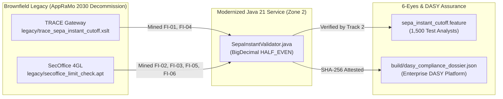

# Living C4 & Arc42 Architecture Documentation — SEPA Instant Modernization (`APPRAMO-4821`)

> **Generated & Synchronized By**: `coba-02-explorer-doku-miner` (Spanner Graph Doku Agent)
> **Knowledge Graph Source**: `projects/coba-sdlc-yellow-prod/instances/coba-adlc-kg/databases/enterprise_knowledge_graph` (`EuroBankEnterpriseSDLCGraph`)

## 1. Cross-Repository Architecture Impact Matrix (Spanner Graph GQL — 182ms)

| Impacted Repository | Symbol / Component | Downstream DB / MQ Contract | Governing BaFin / DORA Document |
|---|---|---|---|
| `coba-sepa-payments` | `SepaInstantValidator.validate()` | `ORACLE: SEPA_OWNER.PKG_LIQUIDITY` | `BaFin_MaRisk_AT_7_2.pdf` (§ 7.2 Change Control) |
| `coba-core-ledger` | `LedgerPostingAdapter.onInstantSettlement()` | `SPANNER: ledger_postings_v2` | `AppRaMo_Target_Arch_v3.pdf` (HALF_EVEN Precision) |
| `coba-aml-screening` | `SanctionsCheckConsumer.onSepaEvent()` | `MQ_TOPIC: CBK.SEPA.INSTANT.V2` | `EU_Instant_Payments_Reg.pdf` (10s SLA & RR04 Freeze) |

## 2. Legacy-to-Java-21 Modernization Topology

